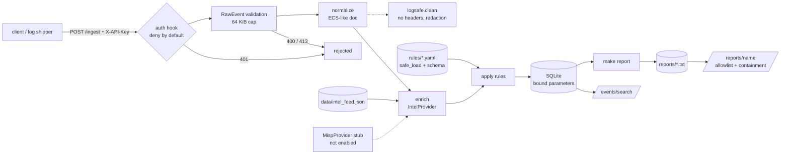

# aegis-log

A small log-enrichment service built for the ULBS Cybersecurity Master,
Module 4 (Risk and Damage Management, AI-driven security engineering).

It receives log events, normalizes them to a small ECS-like shape, tags
events from known-bad IPs using a local threat-intel feed, applies YAML
detection rules, and keeps the results searchable. It stands in for the
ingestion and enrichment stage of a SIEM, cut down to what runs on an 8 GB
laptop.

The service is the subject; the project is the risk work around it. It was
built **deliberately vulnerable** (tag `baseline-vulnerable`, ten seeded bugs
B-01 to B-10), then every bug was fixed in its own pull request behind
repository, CI and AI-agent guardrails. The history reads as the risk
register closing row by row.

## Run it (3 commands)

```bash
make setup     # .venv, dependencies, and a .env with a random API key
make check     # ruff + pytest + bandit + pip-audit (about 15 s)
make run       # http://127.0.0.1:5000 (loopback only)
```

Needs Python 3.11+ and GNU make. On Windows, run `make` from Git Bash.
Clients send the key from `.env` as `X-API-Key`:

```bash
KEY=$(grep ^AEGIS_API_KEY= .env | cut -d= -f2)
curl -s -H "X-API-Key: $KEY" -H "Content-Type: application/json" \
  -d '{"ts":"2026-11-20T08:14:02Z","src_ip":"198.51.100.23","dst_ip":"192.0.2.10","user":"jdoe","message":"vpn: authentication failure"}' \
  http://127.0.0.1:5000/ingest
```

## Endpoints

| Method | Path | Auth | What it does |
|---|---|---|---|
| GET | `/health` | none | liveness, `{"status":"ok"}` |
| POST | `/ingest` | key | validate, normalize, enrich from the intel feed, apply rules, store |
| GET | `/events/search?user=` | key | stored events for one user |
| GET | `/reports/<name>` | key | an allowlisted `.txt` report from `reports/` |
| GET | `/intel/check?ip=` | key | is this IP in the local intel feed? |
| POST | `/admin/rules/reload` | key | reload `rules/*.yaml` (all or nothing) |

Enrichment changes the outcome: an event from a feed IP gets the tag
`threat.indicator.matched` and `risk_score` 70; the same event from a clean
IP stays at 10 (`docs/evidence/enrichment.txt`).

## Architecture



## Guardrail layers

| Layer | Controls | Where |
|---|---|---|
| Repository | PR-only workflow, merge commits, `no-commit-to-branch`, pre-push guard, gitleaks, CODEOWNERS | `.pre-commit-config.yaml`, `scripts/hooks/`, `.github/CODEOWNERS` |
| CI | ruff, pytest, import check, bandit, pip-audit, gitleaks, zizmor; SHA-pinned actions, `contents: read` | `.github/workflows/ci.yml` |
| Governance | every commit on `main` must come from a merged PR | `.github/workflows/governance.yml` |
| AI agent | `CLAUDE.md`, reviewed memory and skills, deny rules, `PreToolUse` guard | `CLAUDE.md`, `memory/`, `skills/`, `.claude/` |

## GitHub route used: 4 (Free + evidence-based governance)

The repository is private on GitHub Free, where branch protection and
rulesets are not available. Direct pushes are refused locally (hooks) and
detected on the server (governance workflow), not prevented. See
`docs/PROJECT.md` section 5 for what is enforced and what is only detected.

## Documents

- `RISK-REGISTER.xlsx`: ten risks, written before any code (built by `scripts/build_register.py`)
- `docs/BUG-REPORT.md`: every seeded bug, its exploit, blast radius, fix and proof, plus bug chains
- `docs/PROJECT.md`: scope, risks, architecture, AI workflow, enforcement, limits
- `docs/evidence/`: red baseline, green final, refused pushes, gitleaks refusal, blocked agent actions, enrichment, CI runs
